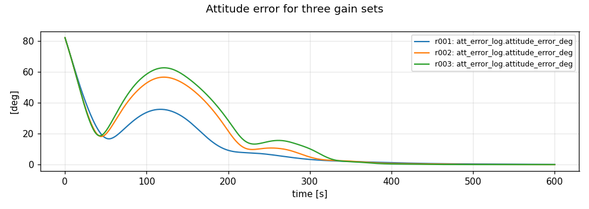
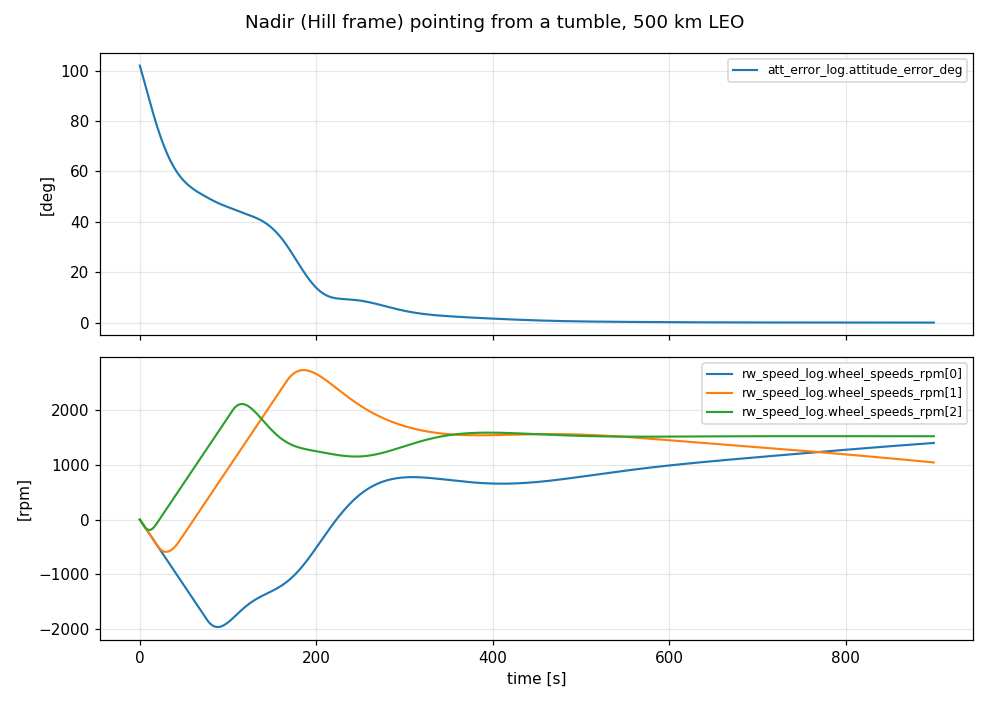

# basilisk-mcp

**A [Model Context Protocol](https://modelcontextprotocol.io) server for the
[Basilisk](https://github.com/AVSLab/basilisk) astrodynamics simulation framework.**

[](https://github.com/recepsuluker/basilisk-mcp/actions/workflows/ci.yml)
[](LICENSE)


basilisk-mcp lets Claude (or any MCP client) build, run and analyze Basilisk
spacecraft simulations from a conversation:

> *"Run the Basilisk reaction-wheel attitude example, then tune the gains so it
> settles below 1° faster without exceeding 4000 rpm, and plot the comparison."*

Claude assembles the scenario from validated building blocks, runs it with real
Basilisk in an isolated process, analyzes the results, and can hand you the exact
standalone Basilisk script that produced them.

<p align="center">
  
  
</p>

> basilisk-mcp is a community project. It is not affiliated with or endorsed by the
> Autonomous Vehicle Systems (AVS) Lab at the University of Colorado Boulder, which
> develops Basilisk.

---

## Highlights

* **Faithful to Basilisk.** Templates reproduce the official
  `scenarioBasicOrbit.py` and `scenarioAttitudeFeedbackRW.py` examples, and the
  test suite checks the recorded data against the unmodified examples.
* **Safe by construction.** No tool executes code. Simulations are assembled from a
  whitelisted catalog of Basilisk modules with type-, unit- and range-checked
  parameters and typed message connections. See [SECURITY.md](SECURITY.md).
* **Reproducible.** Every run is a generated, human-readable Basilisk script, stored
  next to its results. `export_script` returns it, and *what runs is what you export*.
* **Isolated.** Each run executes in a separate, resource-limited worker process
  (`python -I`, minimal environment, timeouts, memory/CPU/file limits).
* **Context-friendly results.** Physics analyses (orbit elements and J2 secular
  rates, settling time, actuator usage), down-sampled queries, run comparisons, PNG
  plots and CSV export, instead of megabytes of raw data.
* **Self-correcting errors.** Every error says what was wrong and what a valid call
  looks like, so Claude can fix its own mistakes.

## How it works

```
┌──────────────────────┐  MCP (stdio or local HTTP)  ┌──────────────────────────────┐
│ Claude Desktop /     │ ◄─────────────────────────► │ basilisk-mcp                 │
│ Claude Code / any    │                             │  validate spec               │
│ MCP client           │                             │  generate Basilisk script    │
└──────────────────────┘                             │  analyze / plot / compare    │
                                                     └──────────────┬───────────────┘
                                                                    │ isolated worker
                                                                    ▼
                                                     ┌──────────────────────────────┐
                                                     │ python -I scenario.py        │
                                                     │ import Basilisk → results    │
                                                     └──────────────────────────────┘
```

A **session** is a declarative spec: modules, parameters, message connections and
recorders. Tools edit the spec; `run_simulation` validates it, generates a standalone
Basilisk script, runs it in a worker and loads the results. The full design is in
[PLAN.md](PLAN.md), and a step-by-step explanation of how an MCP server is built is in
[docs/how-mcp-works.md](docs/how-mcp-works.md).

## Quick start

```bash
git clone https://github.com/recepsuluker/basilisk-mcp.git
cd basilisk-mcp
python -m venv .venv && source .venv/bin/activate     # Windows: .venv\Scripts\activate
pip install -e ".[basilisk]"                          # basilisk-mcp + Basilisk (bsk)
basilisk-mcp doctor                                   # checks Basilisk and runs a smoke simulation
```

### Connect to Claude Desktop

Settings → Developer → Edit Config, then add (use the absolute path from
`which basilisk-mcp`) and restart Claude Desktop:

```json
{
  "mcpServers": {
    "basilisk": {
      "command": "/absolute/path/to/basilisk-mcp/.venv/bin/basilisk-mcp",
      "args": ["serve"]
    }
  }
}
```

### Connect to Claude Code

```bash
claude mcp add --scope user basilisk -- /absolute/path/to/basilisk-mcp/.venv/bin/basilisk-mcp serve
claude mcp list
```

`basilisk-mcp print-config claude-desktop` / `claude-code` prints these snippets with
your paths filled in. Windows paths, team sharing with `.mcp.json`, the local HTTP
transport with bearer tokens, and troubleshooting are covered in
[docs/connecting-claude.md](docs/connecting-claude.md).

### Try it

* *"List the Basilisk templates you can run."*
* *"Compare a 700 km sun-synchronous orbit with and without J2 over three days."*
* *"Build a nadir-pointing 300 kg spacecraft with three HR12 wheels from scratch and
  tell me how long it takes to settle."*

More in [examples/prompts.md](examples/prompts.md).

## Example results

Produced by [`examples/demo_client.py`](examples/demo_client.py), which drives the
server over stdio using only MCP tool calls, the way Claude does. Full write-up:
[examples/RESULTS.md](examples/RESULTS.md).

**Orbit propagation, point mass vs. J2.** 700 km, 98.19° sun-synchronous orbit, three days:

| | Point mass | J2 | J2 analytic |
|---|---|---|---|
| RAAN rate [deg/day] | 0.00000 | 0.99023 | 0.99102 |
| Relative energy drift | −1.0 × 10⁻⁹ | | |

**Attitude control with reaction wheels.** Basilisk's `scenarioAttitudeFeedbackRW`,
then two retuned controllers:

| Gains | Settling time to 1° [s] | Final error [deg] | Peak wheel speed [rpm] |
|---|---|---|---|
| K = 3.5, P = 30 (Basilisk example) | 418 | 0.138 | 2917 |
| K = 7, P = 40 | 386 | 0.025 | 3593 |
| K = 12, P = 60 | 376 | 0.002 | 3778 |

<p align="center">
  
</p>

## Tools

| Group | Tools |
|---|---|
| Discovery | `server_info`, `list_module_types`, `describe_module_type`, `list_templates` |
| Sessions | `create_session`, `list_sessions`, `get_session`, `close_session` |
| Editing | `add_module`, `set_params`, `remove_module`, `connect`, `disconnect`, `add_recorder`, `remove_recorder`, `set_simulation` |
| Checking | `validate_session`, `export_script` |
| Running | `run_simulation`, `list_runs`, `get_run` |
| Results | `query_results`, `analyze_run`, `plot_results`, `compare_runs`, `export_results` |

Prompts: `orbit_study`, `attitude_control_study`. Resources: `basilisk://modules`,
`basilisk://sessions/{session_id}/spec`. Full reference: [docs/tools.md](docs/tools.md).

## Module catalog

| Type | Basilisk | Purpose |
|---|---|---|
| `spacecraft` | `spacecraft.Spacecraft` | rigid hub, initial orbit (elements or r/v) and attitude |
| `gravity` | `simIncludeGravBody` | Earth, Moon, Mars, Sun, Venus, Jupiter; J2 for Earth and Mars |
| `ext_force_torque` | `extForceTorque` | constant or commanded body torque/force |
| `simple_nav` | `simpleNav` | ideal attitude and translational navigation |
| `reaction_wheels` | `reactionWheelStateEffector` + `simIncludeRW` | Honeywell HR12/HR14/HR16 clusters |
| `inertial3d` | `inertial3D` | inertial pointing |
| `hill_point` | `hillPoint` | nadir (Hill frame) pointing |
| `att_tracking_error` | `attTrackingError` | attitude guidance error |
| `mrp_feedback` | `mrpFeedback` | MRP PD/PID attitude control |
| `rw_motor_torque` | `rwMotorTorque` | body torque → wheel motor torques |

Templates: `basic_orbit`, `attitude_feedback_torque`, `attitude_feedback_rw`,
`nadir_pointing_rw`. Every parameter, unit and port is listed in
[docs/modules.md](docs/modules.md).

## Validation

```bash
pip install -e ".[dev]"
pytest
```

The suite (84 tests) covers:

* **Physics.** Reproduction of the official `scenarioAttitudeFeedbackRW.py` (attitude
  error, wheel speeds, motor torques) and `scenarioBasicOrbit.py` (position and
  velocity); point-mass conservation of orbit elements and energy; J2 RAAN drift
  within 2 % of the analytic rate; integrator accuracy ordering; nadir-pointing
  convergence. Reference data comes from the unmodified examples via
  [`tools/generate_reference.py`](tools/generate_reference.py).
* **Security.** Code injection through names and parameters, path traversal, tampered
  session files, worker isolation (environment, `PYTHONPATH`, planted modules),
  timeouts killing process groups, memory limits, HTTP loopback/token enforcement.
* **Validation and MCP flow.** Every parameter kind, port typing, whole-session
  checks, structured errors, and full tool workflows through an MCP client.

## Configuration

Optional TOML file (`basilisk-mcp init-config`), `BASILISK_MCP_*` environment
variables, or CLI flags. Key settings: `data_dir`, `python` (a separate interpreter
with Basilisk), `run_timeout_s`, `max_concurrent_runs`, `max_steps`,
`memory_limit_mb`. See [docs/configuration.md](docs/configuration.md).

## Roadmap

Atmospheric drag, SPICE ephemerides and third-body gravity, thrusters and maneuvers,
sensor noise models, Monte Carlo studies, Vizard output, formation flying. See
[PLAN.md §10](PLAN.md#10-roadmap-after-v01). Contributions are welcome: see
[CONTRIBUTING.md](CONTRIBUTING.md).

## Acknowledgements

[Basilisk](https://avslab.github.io/basilisk/) is developed by the Autonomous Vehicle
Systems (AVS) Lab at the University of Colorado Boulder together with the Laboratory
for Atmospheric and Space Physics (LASP), and is released under the ISC license. If you
publish results obtained with Basilisk, please cite it as its documentation describes. The design of this server was informed by
[GMAT-mcp](https://github.com/dcajacob/GMAT-mcp).

## License

[ISC](LICENSE), matching Basilisk.
