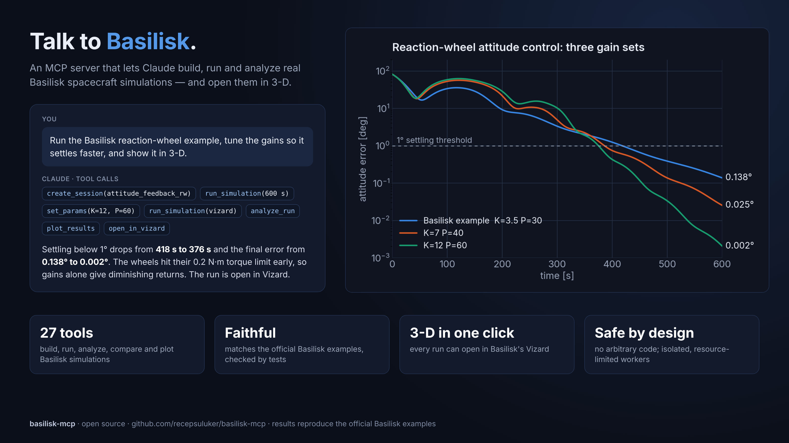
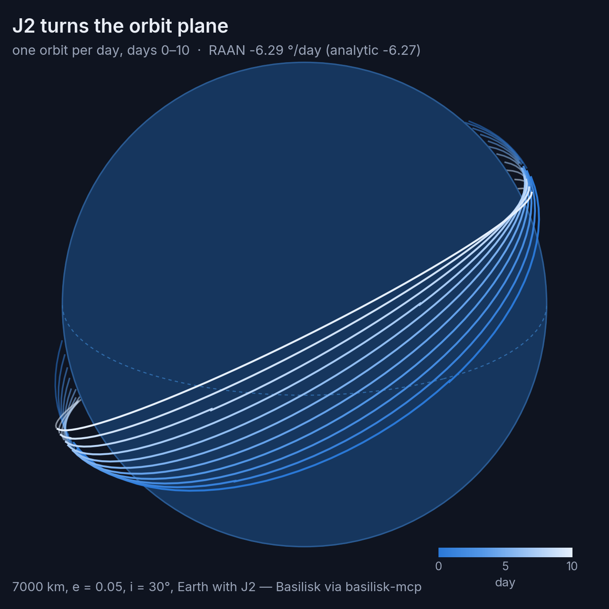
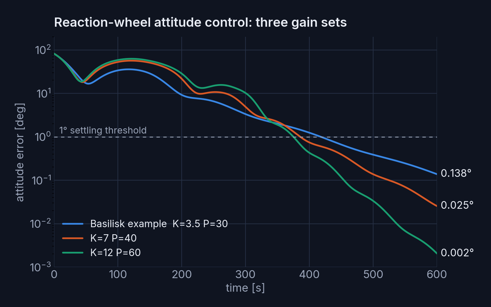

<p align="center">
  
</p>

<h1 align="center">basilisk-mcp</h1>

<p align="center">
  <b>Talk to <a href="https://github.com/AVSLab/basilisk">Basilisk</a>.</b> Plan orbits and tune spacecraft attitude control
  in plain language, with real Basilisk simulations and 3-D playback in Vizard.
</p>

<p align="center">
  <a href="https://github.com/recepsuluker/basilisk-mcp/actions/workflows/ci.yml"></a>
  <a href="LICENSE"></a>
  
  
  
</p>

---

**basilisk-mcp** connects [Claude](https://claude.ai) (or any
[Model Context Protocol](https://modelcontextprotocol.io) client) to **Basilisk**, the
open-source astrodynamics framework from the University of Colorado Boulder. You
describe a spacecraft problem; Claude builds the simulation, runs it with real
Basilisk on your computer, analyzes the results, draws the plots and opens the run
in 3-D.

> *"Run the Basilisk reaction-wheel example, tune the gains so it settles faster, and show it in 3-D."*

Claude answers with numbers you can check (settling time 418 s → 376 s, final error
0.138° → 0.002°), an explanation (the wheels saturate at 0.2 N·m), a comparison
plot, Vizard open on your screen, and, if you ask, the exact Python script it ran.

## What you can ask

| Ask Claude… | You get |
|---|---|
| *"Propagate a 700 km sun-synchronous orbit for three days with and without J2."* | orbit elements, RAAN drift vs. the analytic J2 rate, plots |
| *"Run the reaction-wheel attitude example and tune it to settle under 6 minutes, wheels below 4000 rpm."* | gain sweep, settling times, wheel usage, comparison plot |
| *"Build a 300 kg spacecraft in a 550 km orbit, nadir pointing with three HR12 wheels, starting from a tumble."* | a new scenario from scratch, validated before it runs |
| *"Show it in Vizard."* | the run opens in Basilisk's 3-D visualizer |
| *"Give me the script for that run."* | a standalone Basilisk Python script that reproduces it exactly |

<p align="center">
  
  
</p>
<p align="center"><sub>Both images come from runs made through basilisk-mcp. Left: J2 turns the orbit plane by
−6.29°/day (analytic −6.27°/day). Right: three controller tunings of Basilisk's reaction-wheel example.</sub></p>

## Get started in 5 minutes

You need **Python 3.11+**, **Git** and the **[Claude desktop app](https://claude.ai/download)**.
Basilisk itself is installed automatically from PyPI (`bsk`); nothing has to be compiled.

**1. Install**

<details open>
<summary><b>Windows (PowerShell)</b></summary>

```powershell
winget install Python.Python.3.12     # skip if you already have Python 3.11+
winget install Git.Git                # skip if you already have Git; then reopen PowerShell
cd $HOME
git clone https://github.com/recepsuluker/basilisk-mcp.git
cd basilisk-mcp
py -3.12 -m venv .venv
.venv\Scripts\python -m pip install -e ".[basilisk]"
.venv\Scripts\basilisk-mcp doctor
```
</details>

<details>
<summary><b>macOS / Linux</b></summary>

```bash
git clone https://github.com/recepsuluker/basilisk-mcp.git
cd basilisk-mcp
python3 -m venv .venv
.venv/bin/python -m pip install -e ".[basilisk]"
.venv/bin/basilisk-mcp doctor
```
</details>

`doctor` checks that Basilisk imports and runs a short orbit simulation. Every line
should say `[ok]`.

**2. Connect it to Claude**

```powershell
.venv\Scripts\basilisk-mcp install-claude --vizard-auto-open     # macOS/Linux: .venv/bin/basilisk-mcp …
```

This adds the server to Claude Desktop's configuration, keeps your other servers and
settings, and saves a backup. Then **quit Claude completely** (tray or menu-bar icon
→ *Quit*) and start it again.

**3. (Optional) Install Vizard for 3-D**

Download [Vizard](https://avslab.github.io/basilisk/Vizard/VizardDownload.html) for your
platform and unzip it into your home folder as `Vizard`. Check with
`basilisk-mcp vizard --find`.

**4. Ask**

Open a new chat in Claude and try: *"List the Basilisk templates you can run."* You
should see Claude call tools such as `list_templates` and `create_session`.

Prefer Claude Code, a config file, or the HTTP transport? See
[docs/connecting-claude.md](docs/connecting-claude.md).

## One-click scenarios

Run a scenario and open it in Vizard without opening a chat:

```bash
basilisk-mcp run attitude_feedback_rw            # Basilisk's reaction-wheel example
basilisk-mcp run basic_orbit --duration 86400    # one day of orbit propagation
basilisk-mcp run s1a2b3c4d                       # a scenario you built with Claude
```

```
Run r001 completed in 2.3 s (Basilisk 2.12.2)
  attitude error  82.06 deg -> 0.1378 deg (below 1 deg after 418 s)
  wheels          peak speed 2917 rpm
Opened Vizard: ...\runs\r001\vizard.bin
```

Put these behind desktop shortcuts and each scenario is a double-click:
[docs/one-click.md](docs/one-click.md).

## What's inside

| | |
|---|---|
| **27 MCP tools** | create and edit scenarios, run, analyze (orbit, attitude, actuators), query, plot, compare, export CSV, export script, open in Vizard |
| **Basilisk modules** | spacecraft hub · gravity (Earth, Moon, Mars, Sun, Venus, Jupiter; J2 for Earth and Mars) · reaction wheels (Honeywell HR12/14/16) · external torque · navigation · inertial and nadir pointing · tracking error · MRP feedback control · wheel torque mapping |
| **Templates** | `basic_orbit`, `attitude_feedback_torque`, `attitude_feedback_rw` (mirroring the official Basilisk examples) and `nadir_pointing_rw` |
| **Results** | settling time, final error, wheel speed vs. limit, orbit elements, J2 secular rates, energy drift, plots, CSV |
| **3-D** | any run can record a Vizard file and open it with one call, command or click |

Full references: [tools](docs/tools.md) · [modules and parameters](docs/modules.md) ·
[Vizard](docs/vizard.md) · [configuration](docs/configuration.md).

## Why you can trust the numbers

* **It is real Basilisk.** Each run is a generated, standalone Basilisk script executed
  by Basilisk itself. Ask for it with *"export the script"* and rerun it without the
  server.
* **Checked against the official examples.** Tests reproduce
  `scenarioAttitudeFeedbackRW.py` (attitude error, wheel speeds, motor torques) and
  `scenarioBasicOrbit.py` (position and velocity) from the unmodified Basilisk
  examples, check J2 drift against analytic theory, and verify integrator accuracy.
  More than 100 tests run on Windows, macOS and Linux.
* **Safe by design.** Claude can only assemble catalogued Basilisk modules with
  validated, unit-explicit parameters. No tool runs arbitrary code or touches files
  outside the server's data folder, and every run is an isolated, time- and
  memory-limited process. See [SECURITY.md](SECURITY.md).

## Troubleshooting

| Problem | Fix |
|---|---|
| Claude doesn't use the basilisk tools | Run `basilisk-mcp install-claude` again, then quit Claude from the tray/menu-bar icon and restart it. Older chats may not see new tools: open a new chat. |
| No *Developer* section in Claude's settings | Not needed: `install-claude` edits the configuration file for you. |
| `doctor` says Basilisk can't be imported | Install it in the same environment: `pip install bsk`. |
| Vizard doesn't open | `basilisk-mcp vizard --find`; unzip Vizard to your home folder as `Vizard`, or set `vizard_path` ([docs/vizard.md](docs/vizard.md)). |

More in [docs/connecting-claude.md](docs/connecting-claude.md#8-troubleshooting).

## For developers

* How the server is designed and how to build an MCP server like it:
  [docs/how-mcp-works.md](docs/how-mcp-works.md) and [PLAN.md](PLAN.md)
* Contributing, adding Basilisk modules, regenerating reference data:
  [CONTRIBUTING.md](CONTRIBUTING.md)
* Example results and the script that produces them: [examples/](examples/)

```bash
pip install -e ".[dev]" && pytest
```

## Roadmap

Atmospheric drag and orbit lifetime · thrusters and maneuvers (Δv, Hohmann) · SPICE
ephemerides and third-body gravity · sensor noise models · eclipses and power ·
ground-station access · Monte Carlo studies · live Vizard streaming. Ideas and pull
requests are welcome.

## Acknowledgements

[Basilisk](https://avslab.github.io/basilisk/) is developed by the Autonomous Vehicle
Systems (AVS) Lab at the University of Colorado Boulder together with the Laboratory
for Atmospheric and Space Physics (LASP), and is released under the ISC license. If you
publish results obtained with Basilisk, please cite it as its documentation describes.
The design of this server was informed by [GMAT-mcp](https://github.com/dcajacob/GMAT-mcp).

basilisk-mcp is a community project and is not affiliated with or endorsed by the AVS
Lab, LASP or Anthropic.

## License

[ISC](LICENSE), the same license as Basilisk.
