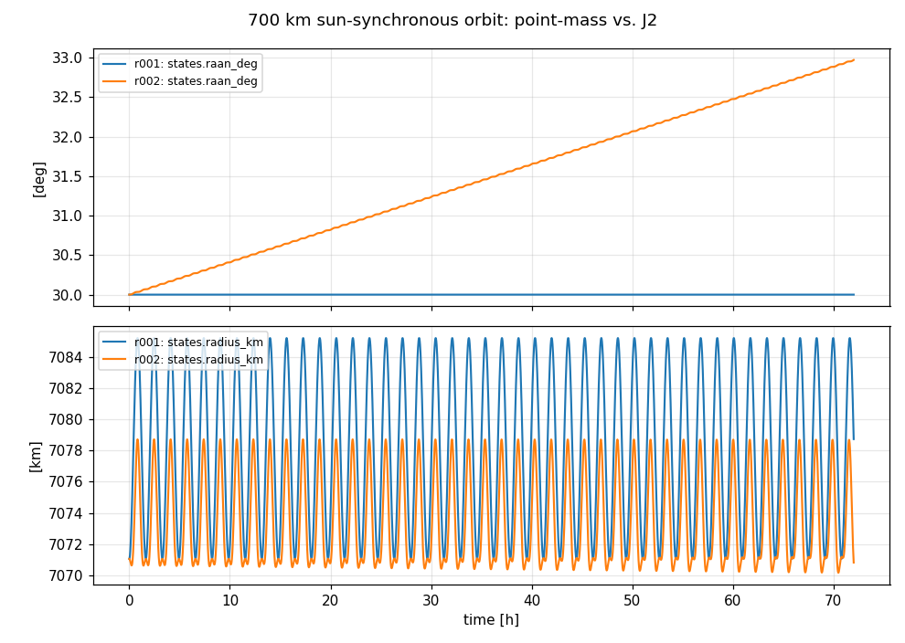
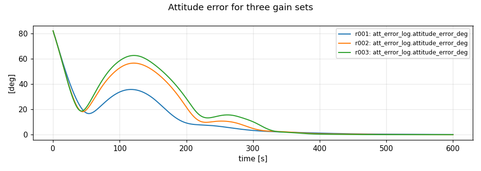
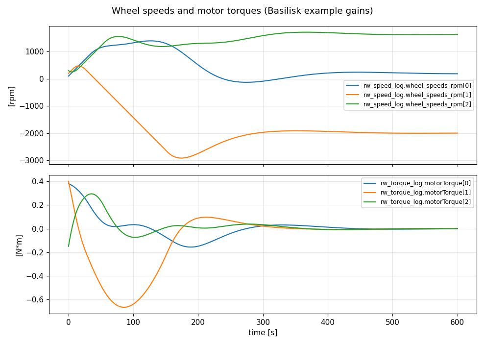
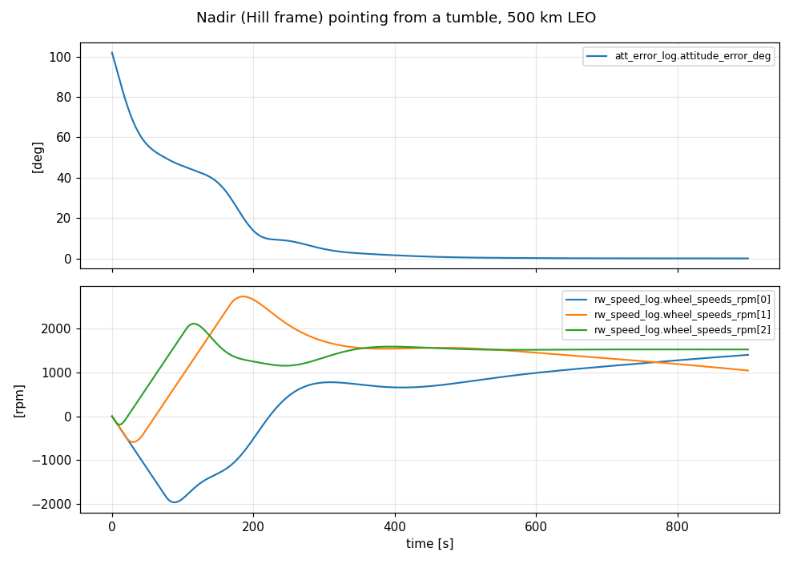

# Example results

Generated by `examples/demo_client.py`, which talks to `basilisk-mcp serve` over stdio using only MCP tool calls, the same way Claude does.

Basilisk 2.12.2 · basilisk-mcp 0.1.0

## 1. Orbit propagation: point-mass vs. J2

A 700 km, 98.19 deg sun-synchronous orbit propagated for three days, first with point-mass Earth gravity, then with the J2 zonal harmonic (`set_params(earth, {j2: true})`).

| Quantity | Point mass | J2 | J2 analytic |
|---|---|---|---|
| RAAN rate [deg/day] | -0.00000 | 0.99023 | 0.99102 |
| Inclination change [deg] | 7.11e-14 | 1.05e-02 | 0 (secular) |
| Semi-major axis range [km] | 0.0000 | 18.293 | short-period only |
| Relative energy drift (point mass) [-] | -1.02e-09 | | |
| Orbital period [min] | 98.773 | 98.773 | |

A sun-synchronous orbit needs a RAAN rate of +0.9856 deg/day (360 deg per year); the J2 run reproduces the analytic rate, while point-mass gravity keeps the plane fixed. The osculating semi-major axis oscillates by about 18 km peak to peak under J2, consistent with the short-period amplitude 1.5*J2*R^2/a = 9.3 km, but does not drift. With e = 0.001 the periapsis is ill-defined, so the analysis reports the argument of latitude instead of the argument of periapsis.

## 2. Attitude control with reaction wheels

The `attitude_feedback_rw` template reproduces Basilisk's `scenarioAttitudeFeedbackRW.py` (three Honeywell HR16 wheels, MRP feedback, inertial pointing). The gains were then changed with `set_params` and the runs compared.

| Gains | Initial error [deg] | Settling time to 1 deg [s] | Final error [deg] | Peak wheel speed [rpm] | Peak motor torque [N*m] |
|---|---|---|---|---|---|
| K=3.5, P=30 (Basilisk example) | 82.1 | 418 | 0.1378 | 2917 | 0.666 |
| K=7, P=40 | 82.1 | 386 | 0.0254 | 3593 | 1.902 |
| K=12, P=60 | 82.1 | 376 | 0.0021 | 3778 | 3.558 |

Peak motor torques above the HR16's 0.2 N*m limit are saturated by the wheel model, so higher gains give diminishing returns.

## 3. Nadir pointing from a tumble

`nadir_pointing_rw`: `hill_point` guidance in a 500 km, 97.4 deg orbit with J2, starting from the same tumbling state as the Basilisk example.

* Initial error: 101.9 deg; final error: 0.0051 deg
* Settling time below 0.5 deg: 494 s
* `export_script` returned a 181-line standalone Basilisk script for this run.

